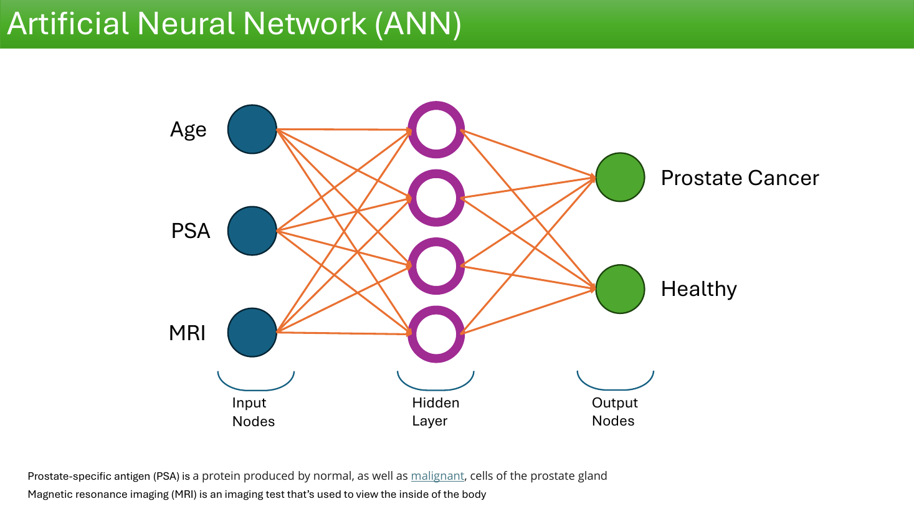
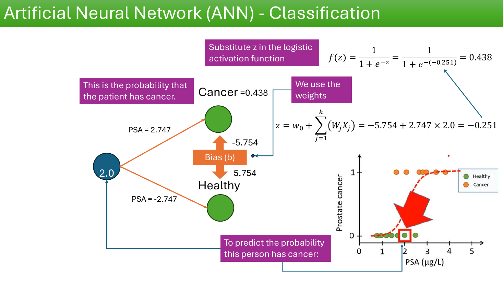
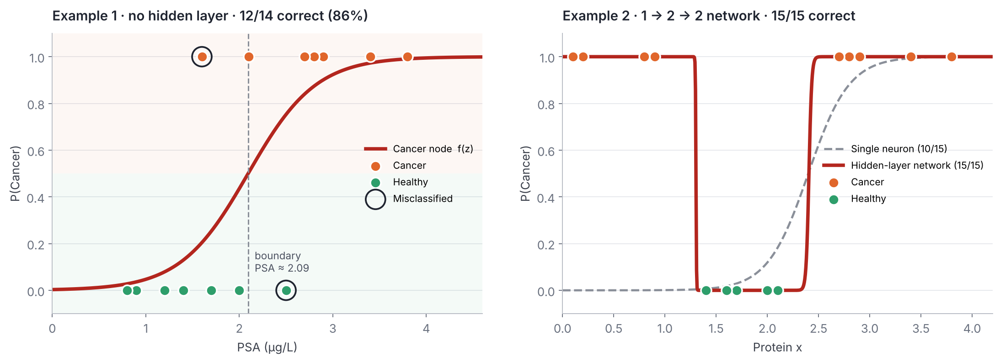

# 🧠 Single Layer Perceptron Workshop: Prostate Cancer Prediction ANN

**Final_Project_Group 1** · Graduate Certificate in Applied AI and Machine Learning, Conestoga College

This repository contains our completed **Single Layer Perceptron Workshop** notebook. It follows the original workshop on artificial neurons, activation functions and logic-gate perceptrons. It then implements the end-of-notebook challenge: the **Prostate Cancer prediction ANN** from the *Deep Learning Fundamentals* class notes, coded in PyTorch and NumPy and explained step by step.

The work forms part of the foundation for **Practical Laboratory 3**.

---

## 👥 Team

| Member | Contribution |
|---|---|
| **Sultan Atanda** | Part 1: three-input prediction (Age, PSA, MRI) and Example 1, one patient step by step (forward pass, threshold, error, gradient descent update) · repository setup and integration |
| **Antonio Sainz** | Part 2: Example 1 on all 14 training patients (accuracy and error analysis) |
| **John Buni** | Part 3: why one sigmoid neuron is not enough · Movies challenge · Gradient Descent and Backpropagation answer |
| **Echezona Oji** | Part 4: Example 2, the hidden-layer network (forward pass and training-set evaluation) |

---

## 🩺 The Problem

The class notes describe a network that predicts **Prostate Cancer** or **Healthy** from clinical inputs. Two simplified examples show how such a network computes its prediction:

| Full network (class notes) | Example 1: PSA → Cancer / Healthy |
|---|---|
|  |  |

- **PSA** (Prostate-Specific Antigen) is a protein produced by normal and malignant prostate cells. Higher levels are linked to cancer.
- Each output neuron computes $z = w_0 + \sum w_j x_j$, then applies the sigmoid $f(z) = \frac{1}{1+e^{-z}}$. A threshold of $\tau = 0.5$ turns the probability into a diagnosis.

---

## 📒 What's in the Notebook

| Section | Content |
|---|---|
| Workshop (original) | Biological vs artificial neurons, activation functions, the Canada's Wonderland case study, and AND / OR / inhibitory logic gates in PyTorch and TensorFlow |
| Homework answer | How gradient descent relates to backpropagation |
| Movies challenge | A custom perceptron (weights `[1, 2, 1]`, bias `-2.5`) where having company matters most |
| **Part 1** | Three-input prediction for the slide 13 patient (Age 62, PSA 2.9, MRI 3), then Example 1 for PSA = 2.0: decision boundary, error, and one autograd weight update |
| **Part 2** | Example 1 run on all 14 patients, reproducing the slide's 86% accuracy |
| **Part 3** | A single sigmoid neuron on the protein-x data, showing why it cannot separate the classes |
| **Part 4** | The trained 1 → 2 → 2 hidden-layer network on the protein-x data |
| Team talking points | Three takeaways from all four parts |

---

## 📊 Key Results



| Model | Data | Training accuracy | Takeaway |
|---|---|---|---|
| Example 1: single neuron | 14 patients, PSA | **12/14 (86%)** | One cut point at PSA ≈ 2.09 µg/L. Overlapping classes cause 1 missed cancer and 1 false alarm. |
| Single neuron | 15 patients, protein x | **10/15 (66.7%)** | A sigmoid is monotonic, so it misses every low-x cancer case. |
| Example 2: hidden layer | 15 patients, protein x | **15/15 (100%)** | Two hidden neurons combine into a "high–low–high" shape that no single S-curve can make. |

> **Note:** all accuracies are measured on the training patients from the class notes. They show what each model can represent, not how well it would perform on new patients.

---

## 💬 Team Talking Points

1. **One neuron can only make one cut.** A single sigmoid neuron is logistic regression in network form: it can only split the input at one point.
2. **A hidden layer changes the shape the model can learn.** Combining two hidden sigmoids lets the network detect cancer at both low and high protein levels.
3. **In medicine, the numbers need context.** A missed cancer costs more than a false alarm, so the threshold is a clinical decision. Real use would need a held-out test set and more inputs, such as Age and MRI.

---

## 🚀 Getting Started

```bash
git clone https://github.com/kinghighshow/SingleLayerPerceptrons_Workshop.git
cd SingleLayerPerceptrons_Workshop

python -m venv .venv
source .venv/bin/activate          # Windows: .venv\Scripts\activate

pip install -r requirements.txt
jupyter notebook SingleLayerPerceptrons_Workshop.ipynb
```

Run the notebook from top to bottom. Part 1 uses an interactive **Plotly** chart, which displays in Jupyter or VS Code but not in GitHub's notebook preview.

---

## 📁 Repository Structure

```
├── SingleLayerPerceptrons_Workshop.ipynb   # Workshop + completed challenges (submission)
├── Wonderland_ANN_Case_Study.ipynb         # Original supporting case study
├── images/                                 # Workshop figures, class-note slides, results chart
├── Base64-Encoded-Images/                  # Embedded diagram sources from the original workshop
├── requirements.txt
└── README.md
```

---

## 📚 References

- Original workshop: [ProfEspinosaAIML/SingleLayerPerceptrons_Workshop](https://github.com/ProfEspinosaAIML/SingleLayerPerceptrons_Workshop)
- *9C Deep Learning Fundamentals*, class notes (Prostate Cancer ANN, slides 12–30)
- Movies perceptron source: [YouTube](https://youtu.be/OFbnpY_k7js)
